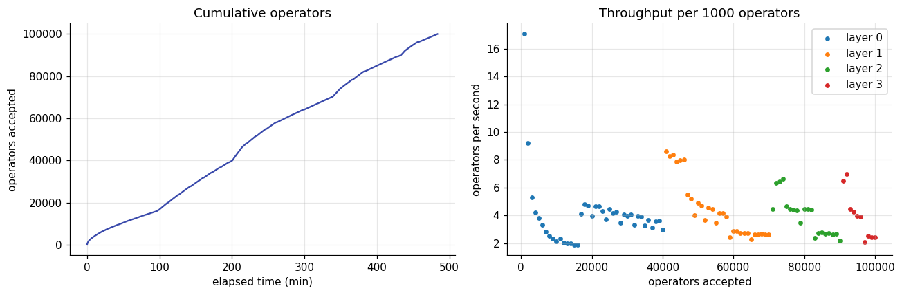
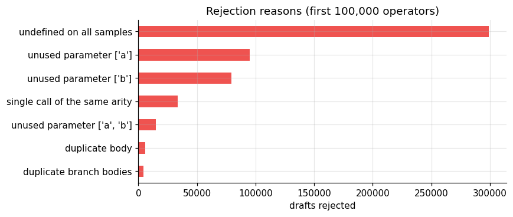
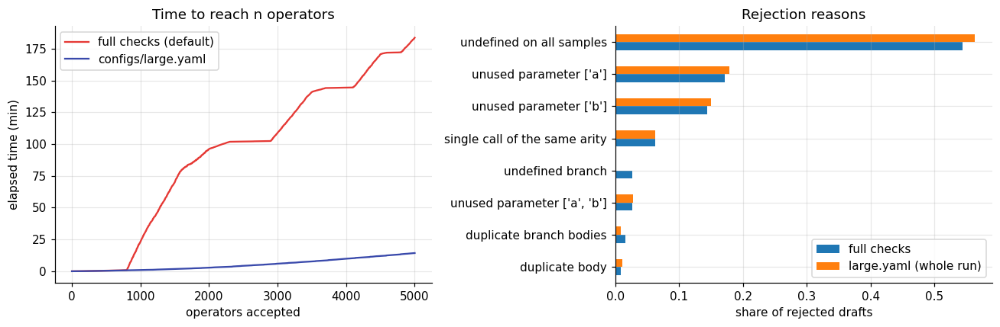
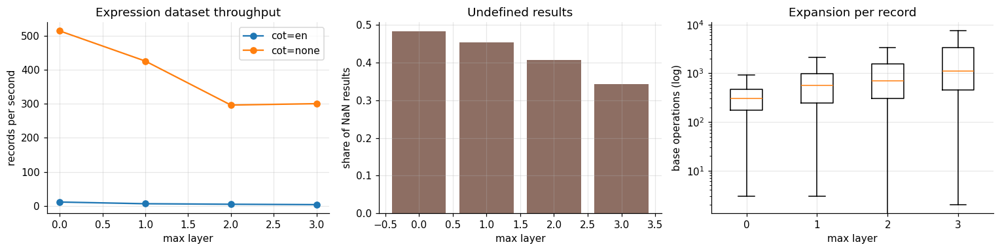
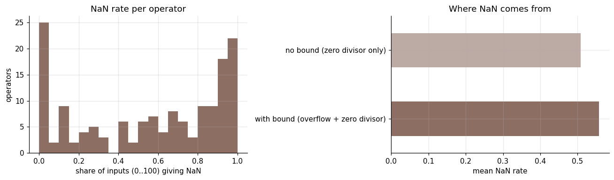
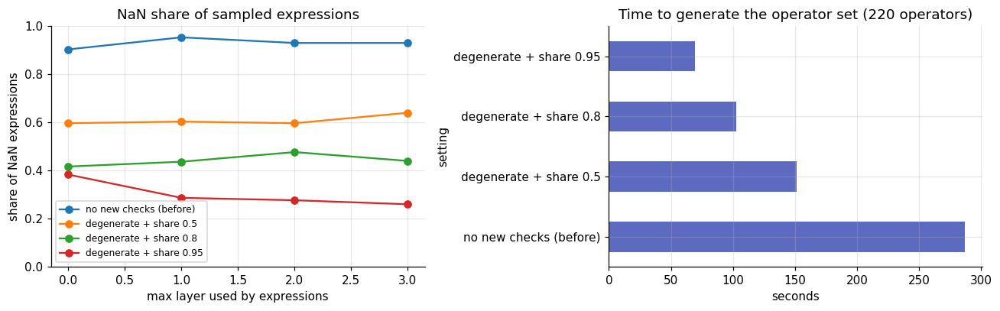
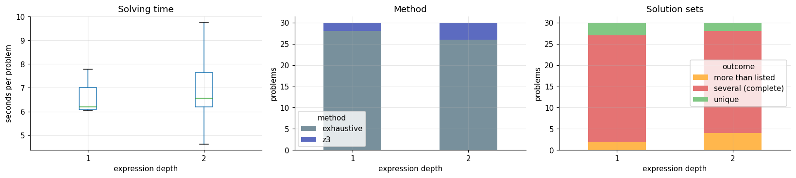
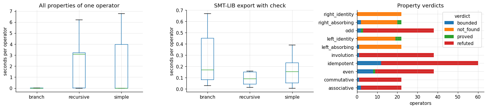

# Performance

Planning a run needs the cost of each stage. `tools/benchmark.py` measured the speeds below on one
machine (64 CPUs, shared with other jobs, Python 3.10); the notebook
`notebooks/generation_benchmark.ipynb` holds the full analysis with all figures.

## Summary

| Stage | Speed |
| --- | ---: |
| generate operators, 100,000 in four layers (`configs/large.yaml`) | 3.45 operators/s (8.1 h in total) |
| generate operators with full branch checks (default), 5,000 | 183.6 min in total |
| differential verification of an operator | 30.4 operators/s |
| expression records, no step-by-step solution | 300 to 510 records/s |
| expression records with a verified step-by-step solution | 3.5 to 11 records/s |
| fill-in-the-blank problem (median) | about 6.6 s |
| all algebraic properties of one operator (median / slowest) | 3 ms / 176 s |
| SMT-LIB export with its check (median) | about 0.15 s |

The 100,000-operator run predates the acceptance checks described below; the other rows use the
current defaults on a 1,000-operator set (four layers).

With worker processes (`--workers 16`) the same set gives 5,079 records/s without step by step
solutions and 45 records/s with them; see
[Pretraining corpora](../guide/corpora.md#generating-faster) for the measurements.

## Growing 100,000 operators

Throughput does not fall as the set grows: every block of 1,000 operators takes about the same
time whether the set holds 5,000 or 95,000 operators. Each new layer starts fast (few callees,
short definitions) and settles at 2 to 5 operators per second. Of the 100,000 symbols, 99,935 have
three characters, as the capacity plan intends (see [Notation](../guide/notation.md#how-many-operators-fit)).

## Full checks against `configs/large.yaml`

Proving that a branch body is never always NaN needs z3 to encode the whole body, and bodies grow
deep in large sets. The full-check run (5,000 operators over four layers) took 183.6 min; the
first 5,000 operators of the `configs/large.yaml` run (all on layer 0) took 14.3 min. The two runs
differ in their layer mix, so the ratio of about 13 is indicative only. `configs/large.yaml` keeps
every other check, including the rejection of unreachable branches.

## Datasets

## Effect of the acceptance checks on NaN answers

Without these checks, 90 to 95% of randomly sampled expressions evaluated to NaN, and a typical
operator was NaN on more than half of the inputs 0 to 100.

Overflow was a small part of it: without a bound the NaN rate barely dropped. Most NaN came from
zero divisors: the generator wrote subexpressions that are always 0, such as `a - a` or `a % a`,
and used them as divisors; such operators passed the old check "defined on at least one sampled
input". Two acceptance checks now prevent this:

* **degenerate subexpressions** (`operators.reject_degenerate`): a subexpression that uses a
  parameter yet takes one value wherever it is defined is rejected; concrete inputs raise the
  suspicion, and only a z3 proof rejects it;
* **defined share** (`operators.min_defined_share`, default 0.95): a total definition must be
  defined on at least that share of inputs from the expression value range. Intentionally partial
  definitions (no `else`, recursion bounded by |v| ≤ T) are exempt.

Same seed, same four layers (220 operators), 300 expressions per point:

| Setting | NaN share (layers 0 to 3) |
| --- | ---: |
| before the fix | 90 to 95% |
| degenerate check + share 0.5 | 60 to 64% |
| degenerate check + share 0.8 | 42 to 48% |
| degenerate check + share 0.95 (default) | 26 to 38% |

The stricter setting also generates faster, because drafts that are NaN almost everywhere are
rejected early instead of being carried into later checks.

## Fill-in-the-blank and analysis

